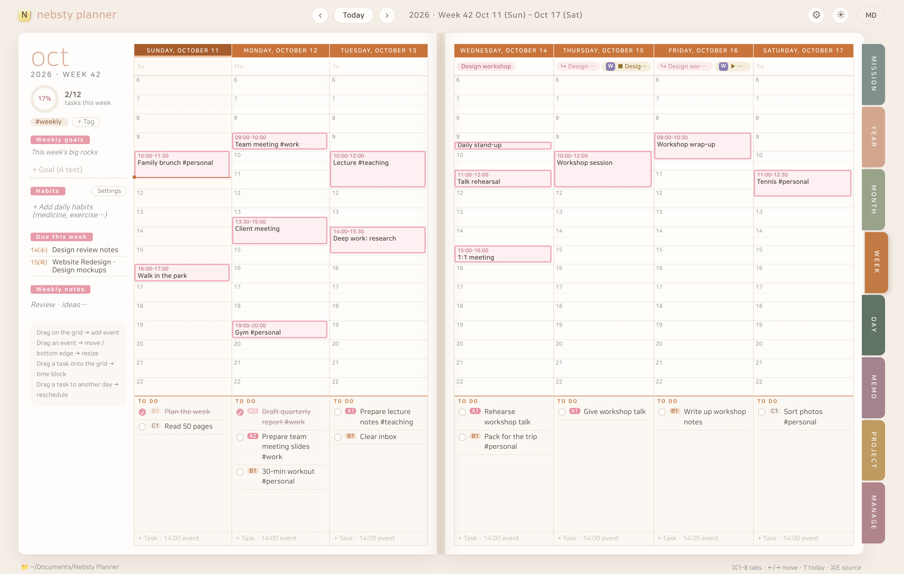
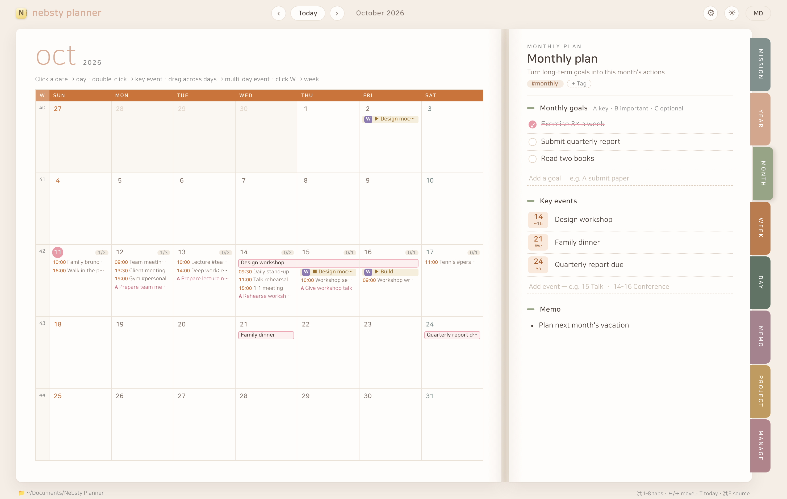
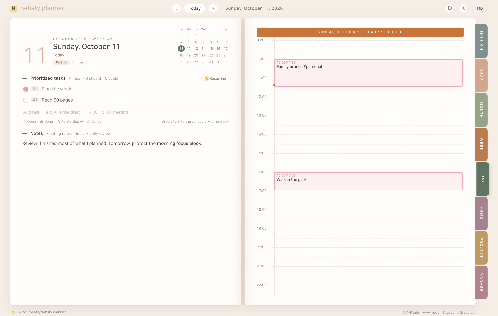
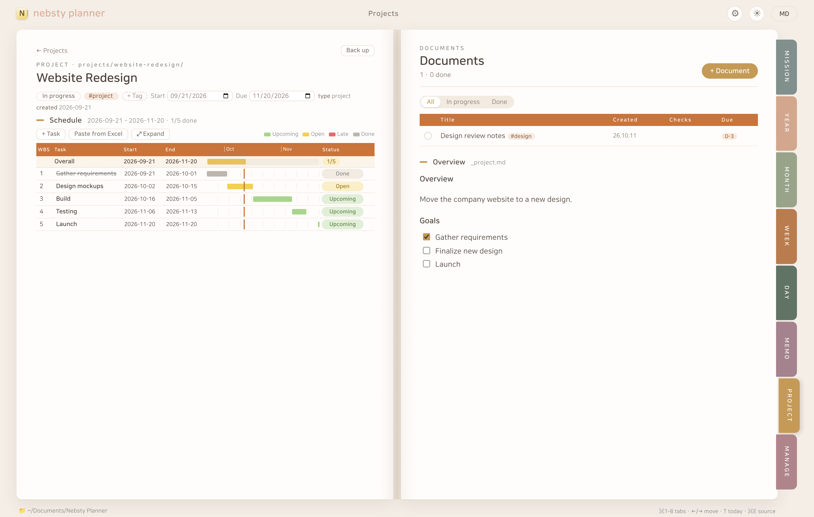
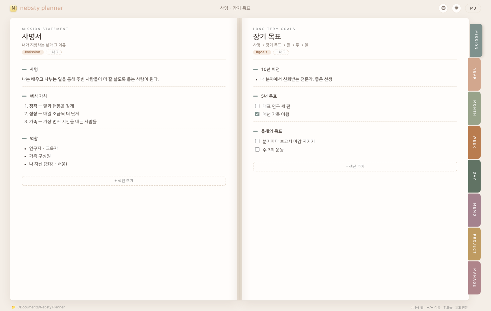

# Nebsty Planner

**From your mission to today's to-do — in one notebook.**
A Franklin-style top-down planner for macOS. Plan from mission → long-term goals → year → month → week → day, turning pages like an open notebook.
Everything is saved as **Markdown files on your Mac**.

> 🧪 **Now in beta.** Each beta build works for about 30 days. When it expires, everything you wrote stays where it is.

**English** · [한국어](ko/)

[⬇︎ Download the beta (macOS)](https://github.com/yang83/nebsty-planner/releases) · [Install](#install) · [Privacy policy](privacy.md) · [Terms](terms.md) · [Send feedback](https://github.com/yang83/nebsty-planner/issues)

---

## What it does

| | |
|---|---|
|  |  |
| **Month** — calendar, monthly goals and key events. Drag across days to add a multi-day event. | **Day** — A·B·C prioritized tasks, a 5 am–midnight schedule, and daily notes. |
|  |  |
| **Projects** — a set of documents plus a WBS schedule with a Gantt chart. Paste straight from Excel. | **Dark mode** · English / 한국어 |

- **Top-down planning** — your mission statement and long-term goals flow into yearly, monthly and weekly goals, and then into today's tasks.
- **Open-notebook layout** — two facing pages; flip with the tabs on the right (⌘1–8).
- **Drag on the schedule** — drag an empty slot to add an event, drag a block to move it, drag a task onto the grid to time-block it.
- **Habits & recurring events** — daily, weekdays, chosen days or monthly. Check off habits in the week view.
- **Memos & project documents** — write in Markdown; drop in images and resize them.
- **Sync with Apple Reminders & Calendar** — edit today's to-dos and your events on either side. Reminder lists and calendars map to tags such as `#personal` or `#work`.
- **Sync with Google Tasks & Google Calendar** — connect your Google account in Settings; works alongside Apple sync, with task lists and calendars mapped to tags the same way.
- **Subscribed calendars (ICS)** — show holidays, school or team calendars in the month, week and day views.
- **Your files stay yours** — every page is a Markdown file in your data folder. Put it in iCloud Drive or Nextcloud to use it on several Macs, or open it in other apps such as Obsidian. Backups and a year-end cleanup are built in.
- **Choose your font** — NanumSquareRound (default), the system font, a serif, or any installed font.

## Install

**Requires:** macOS 13 (Ventura) or later · Apple Silicon or Intel

1. Download `Nebsty-Planner-<version>-beta.dmg` from [Releases](https://github.com/yang83/nebsty-planner/releases).
2. Open the DMG and drag **Nebsty Planner** into **Applications**.
3. The beta is not yet notarized by Apple. If macOS says the developer cannot be verified, open **System Settings › Privacy & Security**, scroll down and click **Open Anyway**. You only need to do this once.
4. To sync with Reminders and Calendar, turn it on in **⚙ Settings › External sync** and allow access when asked. If you don't use sync, the app never asks. For Google, click **Connect Google account…** there and sign in in your browser.

**Where your data lives:** `~/Documents/Nebsty Planner` by default. You can move it to iCloud Drive, Nextcloud or any folder in ⚙ Settings.

## About the beta

- Each beta build has a **time limit of about 30 days**. From 7 days before it ends, the app shows how many days are left; after that it asks you to download the new build.
- **Your data is never affected.** Install the new build and carry on. Even in between, your Markdown files open in any app.
- The app tells you when a new build is out (menu **Nebsty Planner › Check for Updates…** or ⚙ Settings › About).
- Please report bugs, rough edges and wishes in [Issues](https://github.com/yang83/nebsty-planner/issues). A screenshot and your macOS version help a lot.

## FAQ

**Does it need the internet?** No. The planner runs entirely on your Mac. It goes online only to read subscribed calendars, to check for updates, and — if you connect it — to sync with Google.

**Where does my data go?** Nowhere. No accounts, no servers, no analytics. See the [privacy policy](privacy.md).

**Is there a Windows version?** It's in the works.

**What happens after the beta?** The full version will be sold on the Mac App Store.

## License

© 2026 Heesu Yang. All rights reserved. This repository contains only release files and documentation.
Font: NanumSquareRound © NAVER Corporation — [SIL Open Font License 1.1](https://openfontlicense.org).
