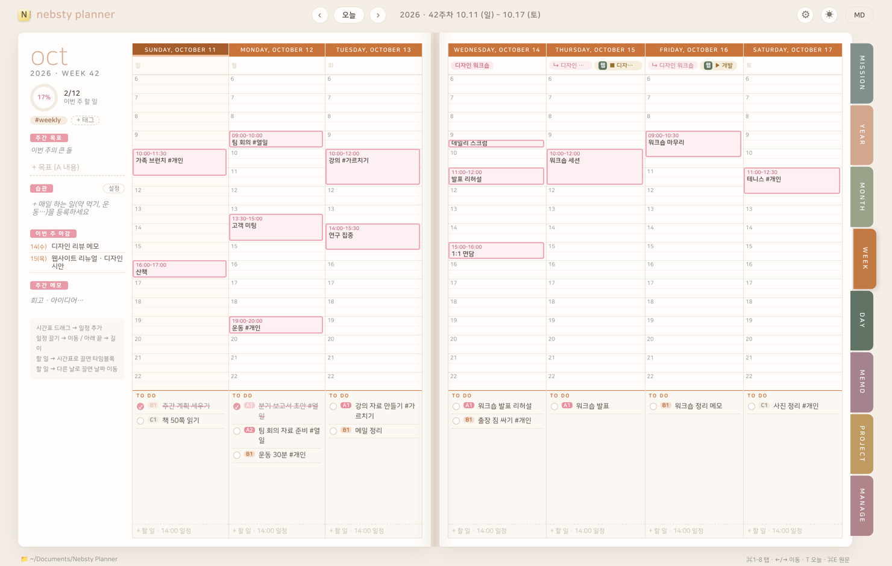
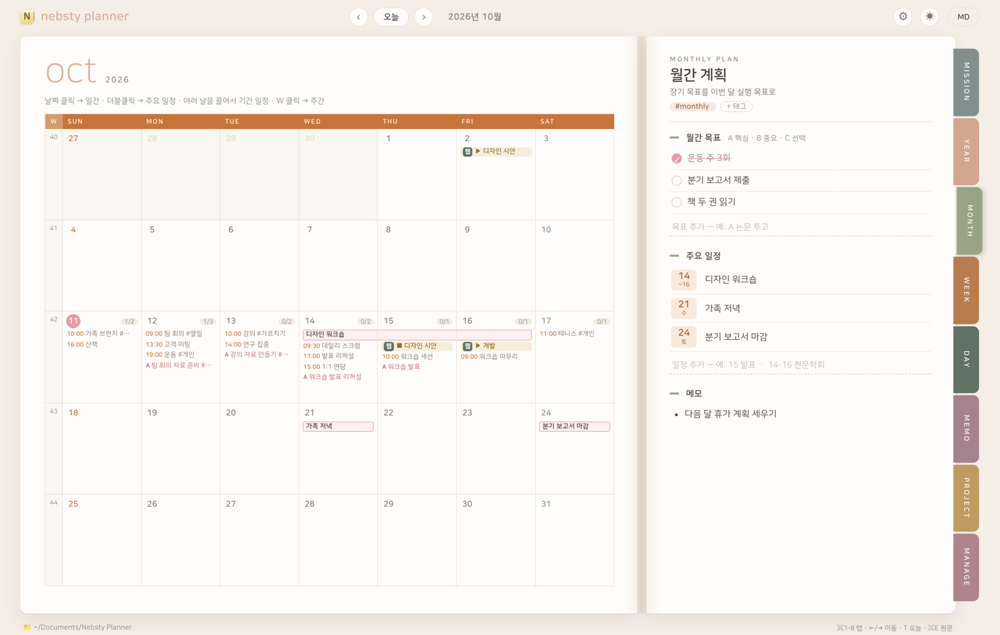
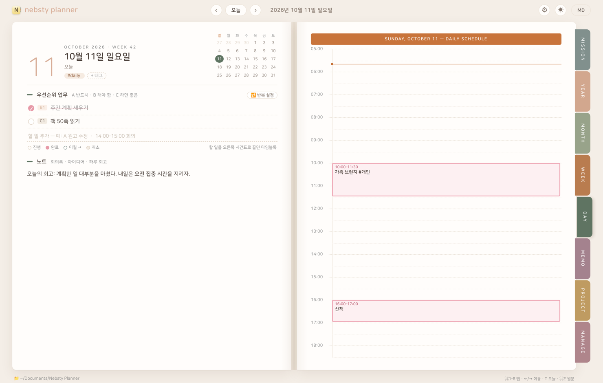
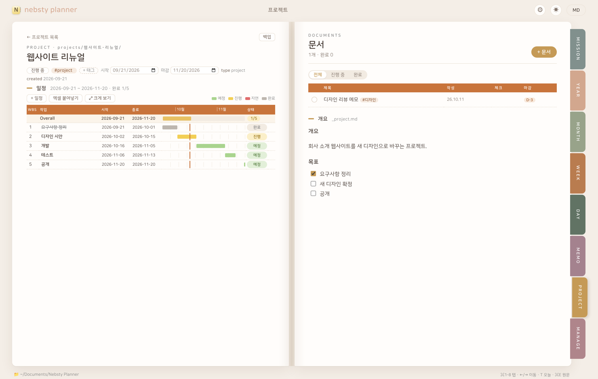
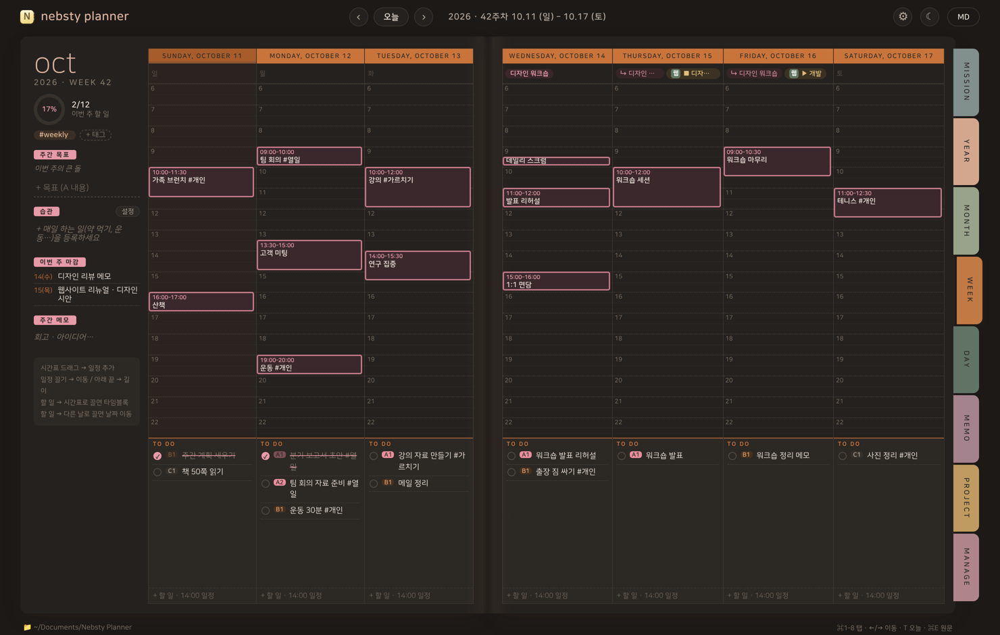

# Nebsty Planner

**사명에서 오늘 할 일까지, 한 권의 노트처럼.**
프랭클린 플래너 방식의 탑다운 플래너 — 사명 → 장기 목표 → 연간 → 월간 → 주간 → 일간을 펼친 노트처럼 넘겨 가며 계획합니다.
모든 내용은 내 Mac 의 **Markdown 파일**로 저장됩니다.

> 🧪 **지금은 베타 테스트 중입니다.** 베타 버전은 받은 날부터 약 30일 동안 쓸 수 있고, 기간이 끝나도 쓴 내용은 그대로 남습니다.

[English](../) · **한국어**

[⬇︎ 베타 받기 (macOS)](https://github.com/yang83/nebsty-planner/releases) · [설치 방법](#설치) · [개인정보 처리방침](privacy.md) · [서비스 약관](terms.md) · [의견 보내기](https://github.com/yang83/nebsty-planner/issues)

---

## 이런 플래너입니다

| | |
|---|---|
|  |  |
| **월간** — 달력 · 월간 목표 · 주요 일정. 여러 날을 끌어 기간 일정을 만듭니다. | **일간** — A·B·C 우선순위 할 일, 05–24시 시간표, 하루 노트. |
|  |  |
| **프로젝트** — 문서 묶음 + WBS 일정표와 간트. 엑셀에서 바로 붙여넣기. | **야간 모드** · 한국어 / English |

- **탑다운 계획** — 사명서와 장기 목표에서 연간 · 월간 · 주간 목표로, 그리고 오늘의 할 일로 이어집니다.
- **펼친 노트 화면** — 왼쪽 · 오른쪽 두 페이지, 오른쪽 탭(⌘1–8)으로 넘깁니다.
- **시간표에서 끌어서** — 빈 칸을 끌면 일정, 블록을 끌면 이동, 할 일을 끌면 타임블록.
- **습관 · 반복 일정** — 매일 · 평일 · 요일 · 매월. 주간 화면에서 습관 체크.
- **메모 · 프로젝트 문서** — Markdown 으로 쓰고, 이미지를 끌어다 놓으면 들어갑니다 (크기 조절 가능).
- **Apple 미리 알림 · 캘린더와 동기화** — 오늘 마감인 할 일과 일정을 양쪽에서 고칠 수 있습니다. 미리 알림 목록 · 캘린더가 `#개인` `#업무` 같은 태그로 이어집니다.
- **메모 · 프로젝트의 📅 할 일** — 메모나 프로젝트 문서에 `- [ ] 할 일 #태그 📅 2026-10-12` 처럼 쓰면 그날의 일간 · 주간 · 월간에 보이고, 그 마감일로 미리 알림 · Google Tasks 와도 동기화됩니다. 누르면 그 메모로, 체크하면 메모에 `✅` 완료 표시.
- **Google Tasks · Google 캘린더와 동기화** — 설정에서 Google 계정을 연결하면 Apple 동기화와 함께 쓸 수 있고, 목록 · 캘린더가 같은 방식으로 태그에 이어집니다.
- **구독 캘린더 (ICS)** — 공휴일 · 학교 · 팀 캘린더를 월간 · 주간 · 일간에 함께 표시.
- **내 파일은 내 것** — 모든 내용이 데이터 폴더의 Markdown 파일. iCloud · Nextcloud 폴더에 두면 여러 Mac 에서 같이 쓰고, Obsidian 같은 다른 앱으로도 열 수 있습니다. 백업 · 연말 정리 기능 포함.
- **글꼴 선택** — 나눔스퀘어라운드(기본) · 시스템 글꼴 · 명조 · 설치된 글꼴.

## 설치

**필요한 것:** macOS 13 (Ventura) 이상 · Apple Silicon / Intel 모두 지원

1. [Releases](https://github.com/yang83/nebsty-planner/releases) 에서 `Nebsty-Planner-<버전>-beta.dmg` 를 받습니다.
2. DMG 를 열고 **Nebsty Planner** 를 **Applications** 폴더로 끌어다 놓습니다.
3. 처음 열 때 *"확인되지 않은 개발자"* 경고가 뜨면 — 베타는 아직 Apple 공증을 받지 않았습니다 —
   **시스템 설정 › 개인정보 보호 및 보안** 맨 아래의 **"그래도 열기"** 를 누르세요. 한 번만 하면 됩니다.
4. 미리 알림 · 캘린더 동기화를 쓰려면 **⚙ 설정 › 외부 동기화**에서 켜고, 묻는 권한을 허용합니다 (쓰지 않으면 권한을 묻지 않습니다). Google 은 같은 곳에서 **Google 계정 연결…** 을 누르고 브라우저에서 로그인합니다.

**데이터 위치:** 기본은 `~/Documents/Nebsty Planner`. ⚙ 설정에서 iCloud Drive · Nextcloud 같은 폴더로 바꿀 수 있습니다.

## 베타 테스트 안내

- 베타 버전마다 **사용 기간(약 30일)** 이 있습니다. 끝나기 7일 전부터 화면 아래에 남은 날이 표시되고, 기간이 지나면 새 버전을 받으라는 안내가 나옵니다.
- **기간이 끝나도 데이터는 그대로입니다.** 새 버전을 설치하면 이어서 쓰고, 그 사이에도 데이터 폴더의 Markdown 파일은 어떤 앱으로든 열 수 있습니다.
- 새 버전이 나오면 앱이 알려 줍니다 (메뉴 **Nebsty Planner › 업데이트 확인…** 또는 ⚙ 설정 › 정보).
- 버그 · 불편한 점 · 바라는 기능은 [Issues](https://github.com/yang83/nebsty-planner/issues) 에 남겨 주세요. 스크린샷과 macOS 버전을 함께 적어 주시면 큰 도움이 됩니다.

## 자주 묻는 질문

**인터넷이 필요한가요?** 아니요. 플래너는 내 Mac 안에서만 동작합니다. 인터넷은 구독 캘린더를 읽을 때, 업데이트를 확인할 때, 그리고 연결한 경우 Google 과 동기화할 때만 씁니다.

**내 데이터를 어디로 보내나요?** 보내지 않습니다. 계정도, 서버도, 사용 통계도 없습니다. 자세한 내용은 [개인정보 처리방침](privacy.md).

**Windows 버전은?** 준비 중입니다.

**정식 버전은?** 베타가 끝나면 Mac App Store 에서 판매할 예정입니다.

## 라이선스

© 2026 Heesu Yang. All rights reserved. 이 저장소에는 배포 파일과 안내 문서만 있습니다.
글꼴: 나눔스퀘어라운드 © NAVER Corporation — [SIL Open Font License 1.1](https://openfontlicense.org).

